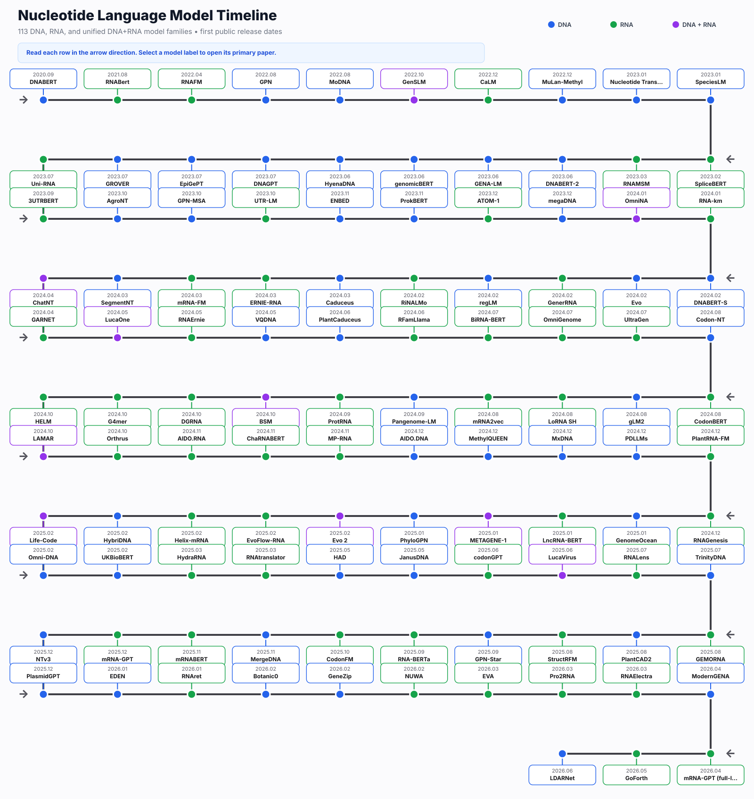
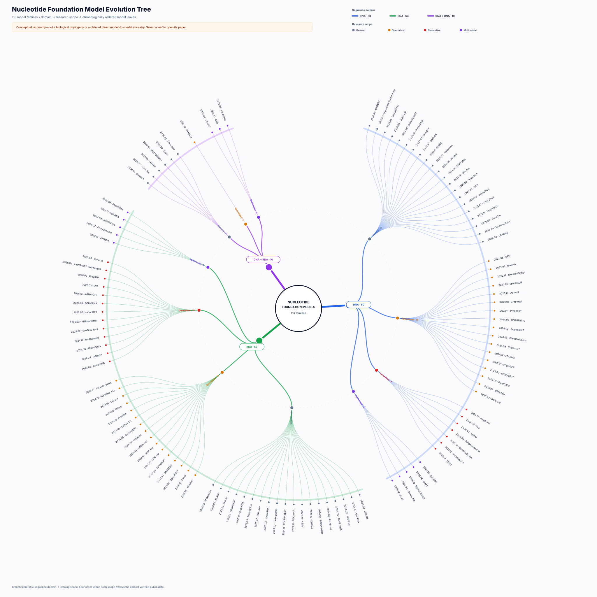

# Awesome Nucleotide Foundation Models

   

A curated, continuously maintained catalog of **DNA, RNA, and unified DNA+RNA sequence language and foundation models**—with structured metadata for papers, code, checkpoints, architectures, tokenization, objectives, training data, scale, and context length.

> **Coverage snapshot (2026-08-29):** **113 models** — 50 DNA, 53 RNA, and 10 DNA+RNA — plus 16 benchmarks and 7 surveys. This is a living catalog: “comprehensive” describes the systematic scope, not a claim that no model can be missing.

> **UltraGen priority claim.** [UltraGen](https://doi.org/10.21203/rs.3.rs-4461517/v1) is **the first RNA language model pre-trained on in vitro-synthesized RNA libraries**, using 10 million experimentally generated UltraSelex sequences.

## Scope

Included entries learn directly from raw nucleotide sequences through self-supervised, autoregressive, diffusion, contrastive, or comparable large-scale pre-training and introduce a reusable representation or generation model. The catalog intentionally includes general models, domain- or organism-specialized models, generative models, and multimodal models in which nucleotide sequence remains a learned modality.

Excluded are ordinary downstream predictors, systems that only consume embeddings from another nucleotide model, RNA-seq or methylation matrices without raw-sequence pre-training, single-cell expression foundation models, protein-only models, and structure systems that do not introduce a reusable nucleotide sequence model. Borderline decisions are documented in [`data/excluded.yaml`](data/excluded.yaml); the exact schema is in [`docs/SCHEMA.md`](docs/SCHEMA.md).

## Contents

- [At a glance](#at-a-glance)
- [Timeline](#timeline)
- [Model evolution tree](#model-evolution-tree)
- [DNA models](#dna-models)
- [RNA models](#rna-models)
- [DNA + RNA models](#dna--rna-models)
- [Model notes](#model-notes)
- [Benchmarks](#benchmarks)
- [Surveys](#surveys)
- [Contributing](#contributing)

## At a glance

| View | Count | What it covers |
|---|---:|---|
| DNA | 50 | Genomes, regulatory DNA, variants, metagenomes, plants, microbes and DNA generation |
| RNA | 53 | ncRNA, mRNA/CDS, UTRs, structure-aware representation and RNA generation/design |
| DNA + RNA | 10 | Unified nucleotide or cross-central-dogma models with explicit DNA and RNA sequence signal |
| General | 46 | Broad reusable nucleotide representations |
| Specialized | 34 | Organism-, region-, process- or task-family-focused pre-training |
| Generative | 20 | Autoregressive, diffusion or conditional sequence design |
| Multimodal | 13 | Nucleotide sequence jointly modeled with structure, function, protein, text or epigenomic information |

Dates in the catalog use the earliest public preprint, model release, or paper that we have verified. A later peer-reviewed publication date is stored separately in the YAML metadata.

## Timeline

## Model evolution tree

This radial tree is a **conceptual catalog taxonomy**, not a biological phylogeny or a claim of direct ancestry between models. It branches by sequence domain and research scope; model leaves are ordered by earliest verified public date within each branch.

[Open the full-size interactive SVG](assets/model_evolution_tree.svg); each model leaf links to its primary paper.

## DNA models

| Model | First public | Scope | Focus | Architecture | Tokenization | Params | Context | Resources |
|---|---:|---|---|---|---|---:|---:|---|
| [LDARNet](https://arxiv.org/abs/2606.04552) | [2026.06](https://arxiv.org/abs/2606.04552) preprint | General | learnable DNA tokenization | Hierarchical BiMamba-2 with local attention | Learned dynamic chunks | 110M | — | [paper](https://arxiv.org/abs/2606.04552) |
| [ModernGENA](https://doi.org/10.64898/2026.04.21.719816) | [2026.04](https://doi.org/10.64898/2026.04.21.719816) preprint | General | efficient general DNA representation | ModernBERT encoder | 32k BPE vocabulary | — | — | [paper](https://doi.org/10.64898/2026.04.21.719816) · [code](https://github.com/AIRI-Institute/GENA_LM) · [weights](https://huggingface.co/AIRI-Institute/moderngena-base) |
| [GeneZip](https://arxiv.org/abs/2602.17739) | [2026.02](https://arxiv.org/abs/2602.17739) preprint | General | adaptive compression for long-context DNA | Dynamic routing compressor plus long-context encoder | Learned region-aware chunks | 70M–636M | Up to 128 kb | [paper](https://arxiv.org/abs/2602.17739) |
| [Botanic0](https://doi.org/10.64898/2026.02.23.706817) | [2026.02](https://doi.org/10.64898/2026.02.23.706817) preprint | Specialized | plant genomes | Transformer encoder family | Genomic sequence tokens | 100M–1B | — | [paper](https://doi.org/10.64898/2026.02.23.706817) · [weights](https://huggingface.co/living-models) |
| [EDEN](https://doi.org/10.64898/2026.01.12.699009) | [2026.01](https://doi.org/10.64898/2026.01.12.699009) preprint | Generative | metagenomic therapeutic design | Large generative sequence model | Nucleotide and protein sequence tokens | Up to 28B | — | [paper](https://doi.org/10.64898/2026.01.12.699009) |
| [PlasmidGPT](https://doi.org/10.64898/2025.12.06.692736) | [2025.12](https://doi.org/10.64898/2025.12.06.692736) preprint | Generative | plasmid generation | GPT-2-style decoder | Nucleotide tokens | — | — | [paper](https://doi.org/10.64898/2025.12.06.692736) |
| [NTv3](https://doi.org/10.64898/2025.12.22.695963) | [2025.12](https://doi.org/10.64898/2025.12.22.695963) preprint | Multimodal | long-range genome-to-function modeling and design | U-Net-like genomic backbone | Single nucleotide | — | Up to 1 Mb | [paper](https://doi.org/10.64898/2025.12.22.695963) · [code](https://github.com/instadeepai/nucleotide-transformer) · [weights](https://huggingface.co/spaces/InstaDeepAI/ntv3) |
| [MergeDNA](https://doi.org/10.1609/aaai.v40i1.37032) | [2025.11](https://arxiv.org/abs/2511.14806) published | General | dynamic genomic tokenization | Hierarchical local tokenizer plus latent Transformer | Context-aware merged tokens | — | — | [paper](https://doi.org/10.1609/aaai.v40i1.37032) |
| [GPN-Star](https://doi.org/10.1101/2025.09.21.677619) | [2025.09](https://doi.org/10.1101/2025.09.21.677619) preprint | Specialized | phylogeny and variant effects | Phylogeny-aware genomic encoder | Single nucleotide with alignment representation | Up to 200M | — | [paper](https://doi.org/10.1101/2025.09.21.677619) · [code](https://github.com/songlab-cal/gpn) · [weights](https://huggingface.co/songlab/gpn-star-hg38-v100-200m) |
| [PlantCAD2](https://doi.org/10.1101/2025.08.27.672609) | [2025.08](https://doi.org/10.1101/2025.08.27.672609) preprint | Specialized | angiosperm genomes | Long-context reverse-complement-aware encoder | Single nucleotide | 676M | 8,192 bp | [paper](https://doi.org/10.1101/2025.08.27.672609) · [weights](https://huggingface.co/kuleshov-group/PlantCAD2-Large-l48-d1536) |
| [TrinityDNA](https://arxiv.org/abs/2507.19229) | [2025.07](https://arxiv.org/abs/2507.19229) preprint | General | bio-inspired long-sequence DNA | Multi-scale attention with groove fusion and gated reverse complement | Single nucleotide | — | — | [paper](https://arxiv.org/abs/2507.19229) |
| [JanusDNA](https://arxiv.org/abs/2505.17257) | [2025.05](https://arxiv.org/abs/2505.17257) preprint | General | bidirectional long-context DNA | Hybrid Mamba–attention mixture-of-experts | Single nucleotide | — | Up to 1M bp | [paper](https://arxiv.org/abs/2505.17257) · [code](https://github.com/Qihao-Duan/JanusDNA) |
| [HAD](https://arxiv.org/abs/2505.20836) | [2025.05](https://arxiv.org/abs/2505.20836) preprint | General | compact genome representation | Hybrid distilled encoder | Nucleotide Transformer tokens | — | — | [paper](https://arxiv.org/abs/2505.20836) |
| [UKBioBERT](https://doi.org/10.1038/s44387-026-00103-4) | [2025.02](https://doi.org/10.1101/2025.02.26.640468) published | Specialized | population variants and functional genomics | Transformer encoder | Nucleotide tokens with population variants | — | — | [paper](https://doi.org/10.1038/s44387-026-00103-4) |
| [Omni-DNA](https://arxiv.org/abs/2502.03499) | [2025.02](https://arxiv.org/abs/2502.03499) preprint | Multimodal | cross-modal and multi-task genomics | Transformer decoder | Nucleotide plus task / modality tokens | 20M–1B | — | [paper](https://arxiv.org/abs/2502.03499) · [weights](https://huggingface.co/collections/zehui127/omni-dna) |
| [HybriDNA](https://arxiv.org/abs/2502.10807) | [2025.02](https://arxiv.org/abs/2502.10807) preprint | General | long-context DNA understanding and generation | Hybrid Transformer–Mamba2 decoder | Single nucleotide | 300M / 3B / 7B | 131 kb | [paper](https://arxiv.org/abs/2502.10807) · [weights](https://huggingface.co/Mishamq/HybriDNA-7B) |
| [PhyloGPN](https://doi.org/10.1007/978-3-031-90252-9_7) | [2025.01](https://doi.org/10.1007/978-3-031-90252-9_7) published | Specialized | phylogeny-aware variant effects | Phylogeny-aware genomic encoder | Single nucleotide | — | — | [paper](https://doi.org/10.1007/978-3-031-90252-9_7) · [code](https://github.com/songlab-cal/gpn) |
| [GenomeOcean](https://doi.org/10.1101/2025.01.30.635558) | [2025.01](https://doi.org/10.1101/2025.01.30.635558) preprint | Generative | global metagenomes and biosynthetic design | Optimized Transformer decoder | BPE | 100M–4B | — | [paper](https://doi.org/10.1101/2025.01.30.635558) · [weights](https://huggingface.co/DOEJGI/GenomeOcean-4B) |
| [PDLLMs](https://doi.org/10.1016/j.molp.2024.12.006) | [2024.12](https://doi.org/10.1016/j.molp.2024.12.006) published | Specialized | plant genomes | Transformer family | Single nucleotide / k-mer / BPE variants | — | — | [paper](https://doi.org/10.1016/j.molp.2024.12.006) |
| [MxDNA](https://arxiv.org/abs/2412.13716) | [2024.12](https://arxiv.org/abs/2412.13716) preprint | General | adaptive DNA tokenization | Sparse mixture-of-convolution tokenization plus encoder | Learned dynamic tokens | — | — | [paper](https://arxiv.org/abs/2412.13716) |
| [MethylQUEEN](https://doi.org/10.1101/2024.12.26.630389) | [2024.12](https://doi.org/10.1101/2024.12.26.630389) preprint | Multimodal | DNA sequence and methylation | Transformer encoder | Methylation-aware nucleotide encoding | — | — | [paper](https://doi.org/10.1101/2024.12.26.630389) |
| [AIDO.DNA](https://doi.org/10.1101/2024.12.01.625444) | [2024.12](https://doi.org/10.1101/2024.12.01.625444) preprint | General | general multi-species DNA | Transformer encoder | Single nucleotide | 7B | 4,096 nt | [paper](https://doi.org/10.1101/2024.12.01.625444) · [code](https://github.com/genbio-ai/AIDO) · [weights](https://huggingface.co/genbio-ai/AIDO.DNA-7B) |
| [Pangenome-LM](https://doi.org/10.1101/2024.09.18.612131) | [2024.09](https://doi.org/10.1101/2024.09.18.612131) preprint | Generative | pangenome-informed synthetic DNA | Autoregressive language model | Pangenome-derived tokenization | — | — | [paper](https://doi.org/10.1101/2024.09.18.612131) |
| [gLM2](https://doi.org/10.1101/2024.08.14.607850) | [2024.08](https://doi.org/10.1101/2024.08.14.607850) preprint | Multimodal | metagenomic DNA and translated proteins | Transformer encoder | Nucleotide and amino-acid tokens | 650M | 4,096 tokens | [paper](https://doi.org/10.1101/2024.08.14.607850) · [weights](https://huggingface.co/tattabio/gLM2_650M) |
| [Codon-NT](https://doi.org/10.1093/bioinformatics/btae529) | [2024.08](https://doi.org/10.1093/bioinformatics/btae529) published | Specialized | codon-aware genomic representation | Transformer encoder | Non-overlapping 3-mer / codon | 50M | 2,048 tokens | [paper](https://doi.org/10.1093/bioinformatics/btae529) · [code](https://github.com/instadeepai/nucleotide-transformer) · [weights](https://huggingface.co/InstaDeepAI/nucleotide-transformer-v2-50m-3mer-multi-species) |
| [PlantCaduceus](https://doi.org/10.1073/pnas.2421738122) | [2024.06](https://doi.org/10.1101/2024.06.04.596709) published | Specialized | plant genomes | Caduceus / BiMamba encoder | Single nucleotide | — | Long-context single-base modeling | [paper](https://doi.org/10.1073/pnas.2421738122) |
| [VQDNA](https://arxiv.org/abs/2405.10812) | [2024.05](https://arxiv.org/abs/2405.10812) preprint | General | learned genomic vocabulary | Vector-quantized encoder | Learned hierarchical codebooks | — | — | [paper](https://arxiv.org/abs/2405.10812) |
| [SegmentNT](https://doi.org/10.1038/s41592-025-02881-2) | [2024.03](https://doi.org/10.1101/2024.03.14.584712) published | Specialized | base-resolution genome annotation | U-Net decoder over Nucleotide Transformer | 6-mer input; single-base output | — | 30–50 kb | [paper](https://doi.org/10.1038/s41592-025-02881-2) · [code](https://github.com/instadeepai/nucleotide-transformer) · [weights](https://huggingface.co/InstaDeepAI/segment_nt) |
| [Caduceus](https://arxiv.org/abs/2403.03234) | [2024.03](https://arxiv.org/abs/2403.03234) published | General | long-context and reverse-complement-aware DNA | Reverse-complement-equivariant BiMamba | Single nucleotide | 0.47M / 1.9M | 131 kb | [paper](https://arxiv.org/abs/2403.03234) · [code](https://github.com/kuleshov-group/caduceus) · [weights](https://huggingface.co/kuleshov-group/caduceus-ps_seqlen-131k_d_model-256_n_layer-16) |
| [regLM](https://doi.org/10.1101/gr.279142.124) | [2024.02](https://doi.org/10.1101/2024.02.14.580373) published | Generative | regulatory DNA design | Hyena decoder | Single nucleotide plus condition tokens | 6.55M | 160 kb pre-training | [paper](https://doi.org/10.1101/gr.279142.124) · [code](https://github.com/Genentech/regLM) |
| [Evo](https://doi.org/10.1126/science.ado9336) | [2024.02](https://doi.org/10.1101/2024.02.27.582234) published | Generative | microbial genome understanding and design | StripedHyena decoder | Single nucleotide | 7B | 131 kb pre-training; up to 650 kb generation | [paper](https://doi.org/10.1126/science.ado9336) · [code](https://github.com/evo-design/evo) · [weights](https://huggingface.co/togethercomputer/evo-1-131k-base) |
| [DNABERT-S](https://arxiv.org/abs/2402.08777) | [2024.02](https://arxiv.org/abs/2402.08777) published | Specialized | species-aware genome embeddings | Transformer encoder | BPE | 117M | — | [paper](https://arxiv.org/abs/2402.08777) · [code](https://github.com/MAGICS-LAB/DNABERT_S) · [weights](https://huggingface.co/zhihan1996/DNABERT-S) |
| [megaDNA](https://doi.org/10.1038/s41467-024-53759-4) | [2023.12](https://doi.org/10.1101/2023.12.18.572218) published | Generative | bacteriophage genomes | Multiscale Transformer decoder | Single nucleotide | 145M | 96 kb | [paper](https://doi.org/10.1038/s41467-024-53759-4) · [code](https://github.com/lingxusb/megaDNA) |
| [ProkBERT](https://doi.org/10.3389/fmicb.2023.1331233) | [2023.11](https://doi.org/10.1101/2023.11.09.566411) published | Specialized | microbial genomes and microbiomes | Transformer encoder | Local Context-Aware k-mer | — | — | [paper](https://doi.org/10.3389/fmicb.2023.1331233) · [code](https://github.com/nbrg-ppcu/prokbert) · [weights](https://huggingface.co/neuralbioinfo/prokbert-mini) |
| [ENBED](https://doi.org/10.1093/bioadv/vbae117) | [2023.11](https://arxiv.org/abs/2311.02333) published | General | base-precision DNA understanding and generation | Efficient Transformer encoder–decoder | Single nucleotide / byte level | — | — | [paper](https://doi.org/10.1093/bioadv/vbae117) |
| [GPN-MSA](https://doi.org/10.1038/s41587-024-02511-w) | [2023.10](https://doi.org/10.1101/2023.10.10.561776) published | Specialized | alignment-based variant effects | Convolutional sequence model | Single nucleotide with MSA channels | — | — | [paper](https://doi.org/10.1038/s41587-024-02511-w) · [code](https://github.com/songlab-cal/gpn) · [weights](https://huggingface.co/songlab/gpn-msa-sapiens) |
| [AgroNT](https://doi.org/10.1038/s42003-024-06465-2) | [2023.10](https://doi.org/10.1101/2023.10.24.563624) published | Specialized | plant and crop genomes | Transformer encoder | Non-overlapping 6-mer | 1B | 1,025 tokens | [paper](https://doi.org/10.1038/s42003-024-06465-2) · [code](https://github.com/instadeepai/nucleotide-transformer) · [weights](https://huggingface.co/InstaDeepAI/agro-nucleotide-transformer-1b) |
| [GROVER](https://doi.org/10.1038/s42256-024-00872-0) | [2023.07](https://doi.org/10.1101/2023.07.19.549677) published | General | human genome | Transformer encoder | BPE | — | 510 tokens | [paper](https://doi.org/10.1038/s42256-024-00872-0) · [code](https://doi.org/10.5281/zenodo.8373202) · [weights](https://huggingface.co/PoetschLab/GROVER) |
| [EpiGePT](https://doi.org/10.1186/s13059-024-03449-7) | [2023.07](https://doi.org/10.1186/s13059-024-03449-7) published | Multimodal | sequence and epigenomics | Transformer encoder | Genomic bins / sequence features | — | — | [paper](https://doi.org/10.1186/s13059-024-03449-7) · [code](https://github.com/ZjGaothu/EpiGePT) |
| [DNAGPT](https://arxiv.org/abs/2307.05628) | [2023.07](https://arxiv.org/abs/2307.05628) preprint | General | DNA understanding and generation | Transformer decoder | Non-overlapping k-mer | 0.1B / 3B | 3,072–24,576 bp | [paper](https://arxiv.org/abs/2307.05628) · [code](https://github.com/TencentAILabHealthcare/DNAGPT) |
| [HyenaDNA](https://arxiv.org/abs/2306.15794) | [2023.06](https://arxiv.org/abs/2306.15794) published | General | long-context genome modeling | Hyena decoder | Single nucleotide | 0.4M–6.6M | Up to 1M nt | [paper](https://arxiv.org/abs/2306.15794) · [code](https://github.com/HazyResearch/hyena-dna) · [weights](https://huggingface.co/LongSafari/hyenadna-large-1m-seqlen-hf) |
| [genomicBERT](https://doi.org/10.1101/2023.05.31.542682) | [2023.06](https://doi.org/10.1101/2023.05.31.542682) preprint | General | general genome representation | Transformer encoder | Unigram DNA vocabulary | — | — | [paper](https://doi.org/10.1101/2023.05.31.542682) |
| [GENA-LM](https://doi.org/10.1093/nar/gkae1310) | [2023.06](https://doi.org/10.1101/2023.06.12.544594) published | General | long genomic sequences | BERT / BigBird encoder | BPE | 110M–340M | Up to 36 kb | [paper](https://doi.org/10.1093/nar/gkae1310) · [code](https://github.com/AIRI-Institute/GENA_LM) · [weights](https://huggingface.co/AIRI-Institute/gena-lm-bigbird-base-t2t) |
| [DNABERT-2](https://arxiv.org/abs/2306.15006) | [2023.06](https://arxiv.org/abs/2306.15006) published | General | multi-species genomes | Transformer encoder with ALiBi | BPE | 117M | About 700 bp pre-training; longer at inference | [paper](https://arxiv.org/abs/2306.15006) · [code](https://github.com/MAGICS-LAB/DNABERT_2) · [weights](https://huggingface.co/zhihan1996/DNABERT-2-117M) |
| [SpeciesLM](https://doi.org/10.1186/s13059-024-03221-x) | [2023.01](https://doi.org/10.1101/2023.01.26.525670) published | Specialized | cross-species regulatory genomics | Transformer encoder | Single nucleotide / overlapping k-mer | 90M | 1 kb | [paper](https://doi.org/10.1186/s13059-024-03221-x) · [code](https://github.com/DennisGankin/species-aware-DNA-LM) · [weights](https://huggingface.co/gagneurlab/SpeciesLM) |
| [Nucleotide Transformer](https://doi.org/10.1038/s41592-024-02523-z) | [2023.01](https://doi.org/10.1101/2023.01.11.523679) published | General | human and multi-species genomes | Transformer encoder | Non-overlapping 6-mer | 50M–2.5B | 1,000–2,048 tokens | [paper](https://doi.org/10.1038/s41592-024-02523-z) · [code](https://github.com/instadeepai/nucleotide-transformer) · [weights](https://huggingface.co/collections/InstaDeepAI/nucleotide-transformer-65099cdde13ff96230f2e592) |
| [MuLan-Methyl](https://doi.org/10.1093/gigascience/giad054) | [2022.12](https://doi.org/10.1093/gigascience/giad054) published | Specialized | DNA methylation | Transformer ensemble | k-mer and learned vocabularies | — | — | [paper](https://doi.org/10.1093/gigascience/giad054) |
| [MoDNA](https://doi.org/10.1145/3535508.3545512) | [2022.08](https://doi.org/10.1145/3535508.3545512) published | Specialized | motif-aware genome modeling | Transformer encoder | k-mer | — | — | [paper](https://doi.org/10.1145/3535508.3545512) |
| [GPN](https://doi.org/10.1073/pnas.2311219120) | [2022.08](https://doi.org/10.1101/2022.08.22.504706) published | Specialized | evolution and variant effects | Dilated convolutional encoder | Single nucleotide | — | — | [paper](https://doi.org/10.1073/pnas.2311219120) · [code](https://github.com/songlab-cal/gpn) · [weights](https://huggingface.co/songlab/gpn-brassicales) |
| [DNABERT](https://doi.org/10.1093/bioinformatics/btab083) | [2020.09](https://doi.org/10.1101/2020.09.17.301879) published | General | human genome | Transformer encoder | Overlapping 3–6-mer | 110M | 512 tokens | [paper](https://doi.org/10.1093/bioinformatics/btab083) · [code](https://github.com/jerryji1993/DNABERT) · [weights](https://huggingface.co/zhihan1996/DNA_bert_6) |

## RNA models

| Model | First public | Scope | Focus | Architecture | Tokenization | Params | Context | Resources |
|---|---:|---|---|---|---|---:|---:|---|
| [GoForth](https://arxiv.org/abs/2605.07608) | [2026.05](https://arxiv.org/abs/2605.07608) preprint | Generative | constraint-aware RNA design | Transformer encoder–decoder | RNA sequence, structure and coding-condition tokens | — | — | [paper](https://arxiv.org/abs/2605.07608) |
| [mRNA-GPT (full-length)](https://doi.org/10.64898/2026.03.31.715707) | [2026.04](https://doi.org/10.64898/2026.03.31.715707) preprint | Generative | full-length mRNA design | Autoregressive Transformer decoder | Region-aware mRNA tokens | — | — | [paper](https://doi.org/10.64898/2026.03.31.715707) |
| [RNAElectra](https://doi.org/10.64898/2026.03.15.711950) | [2026.03](https://doi.org/10.64898/2026.03.15.711950) preprint | General | non-coding RNA | Encoder-only | SNT | — | — | [paper](https://doi.org/10.64898/2026.03.15.711950) |
| [Pro2RNA](https://doi.org/10.64898/2026.03.18.712790) | [2026.03](https://doi.org/10.64898/2026.03.18.712790) preprint | Generative | protein- and host-conditioned mRNA design | Multimodal sequence-to-sequence model | Codon, amino-acid and taxonomy tokens | — | — | [paper](https://doi.org/10.64898/2026.03.18.712790) |
| [EVA](https://www.biorxiv.org/content/10.64898/2026.03.17.712398v2) | [2026.03](https://www.biorxiv.org/content/10.64898/2026.03.17.712398v2) preprint | Generative | RNA generation and design | Decoder-only (MoE) | - | — | — | [paper](https://www.biorxiv.org/content/10.64898/2026.03.17.712398v2) |
| [NUWA](https://www.biorxiv.org/content/10.1101/2025.11.01.686058v3) | [2026.02](https://www.biorxiv.org/content/10.1101/2025.11.01.686058v3) preprint | General | mRNA / coding sequence | Encoder-only | Codon tokens | — | — | [paper](https://www.biorxiv.org/content/10.1101/2025.11.01.686058v3) · [code](https://github.com/zysxmu/NUWA) |
| [RNAret](https://www.nature.com/articles/s42003-026-09757-x) | [2026.01](https://doi.org/10.5281/zenodo.18271233) published | General | non-coding RNA | Hybrid (RetNet) | 1/3/5-mer | 12M | — | [paper](https://www.nature.com/articles/s42003-026-09757-x) · [code](https://github.com/DrBlackZJU/RNAret/) |
| [mRNA-GPT](https://www.biorxiv.org/content/10.64898/2025.12.22.695962v1) | [2025.12](https://www.biorxiv.org/content/10.64898/2025.12.22.695962v1) preprint | Generative | mRNA / coding sequence | Decoder-only | Codon / nucleotide | 302M | — | [paper](https://www.biorxiv.org/content/10.64898/2025.12.22.695962v1) · [code](https://github.com/ZHymLumine/mRNA-GPT/) |
| [mRNABERT](https://www.nature.com/articles/s41467-025-65340-8) | [2025.11](https://www.nature.com/articles/s41467-025-65340-8) published | General | mRNA / coding sequence | Encoder-only | Dual tokenization | 114M | — | [paper](https://www.nature.com/articles/s41467-025-65340-8) · [weights](https://huggingface.co/Taykhoom/mRNABERT) |
| [CodonFM](https://developer.nvidia.com/blog/introducing-the-codonfm-open-model-for-rna-design-and-analysis/) | [2025.10](https://developer.nvidia.com/blog/introducing-the-codonfm-open-model-for-rna-design-and-analysis/) published | General | mRNA / coding sequence | Encoder-only | Codon-level | 80M / 600M / 1B | — | [paper](https://developer.nvidia.com/blog/introducing-the-codonfm-open-model-for-rna-design-and-analysis/) · [code](https://github.com/NVIDIA-Digital-Bio/CodonFM) · [weights](https://huggingface.co/nvidia/NV-CodonFM-Encodon-1B-v1) |
| [RNA-BERTa](https://www.biorxiv.org/content/10.1101/2025.09.05.674445v1) | [2025.09](https://www.biorxiv.org/content/10.1101/2025.09.05.674445v1) preprint | General | non-coding RNA | Encoder-only | BPE | 55.9M | — | [paper](https://www.biorxiv.org/content/10.1101/2025.09.05.674445v1) · [weights](https://huggingface.co/IlPakoZ/RNA-BERTa9700) |
| [StructRFM](https://www.biorxiv.org/content/10.1101/2025.08.06.668731v1) | [2025.08](https://www.biorxiv.org/content/10.1101/2025.08.06.668731v1) preprint | Multimodal | sequence and RNA structure | Encoder-only | SNT | — | — | [paper](https://www.biorxiv.org/content/10.1101/2025.08.06.668731v1) · [code](https://github.com/heqin-zhu/structRFM) |
| [GEMORNA](https://doi.org/10.1126/science.adr8470) | [2025.08](https://doi.org/10.1126/science.adr8470) published | Generative | full-length therapeutic mRNA | Region-specific Transformer generators | UTR and codon-aware tokens | — | — | [paper](https://doi.org/10.1126/science.adr8470) |
| [RNALens](https://www.biorxiv.org/content/10.1101/2025.07.20.665722v1) | [2025.07](https://www.biorxiv.org/content/10.1101/2025.07.20.665722v1) preprint | General | general RNA | Encoder-only | BPE | 469M | — | [paper](https://www.biorxiv.org/content/10.1101/2025.07.20.665722v1) · [code](https://github.com/oomics/RNALens) |
| [codonGPT](https://academic.oup.com/nar/article/53/22/gkaf1345/8384118) | [2025.06](https://doi.org/10.1101/2025.06.25.661500) published | Generative | mRNA / coding sequence | Decoder-only | Codon-level | GPT-2 based | — | [paper](https://academic.oup.com/nar/article/53/22/gkaf1345/8384118) · [weights](https://huggingface.co/naniltx/codonGPT) |
| [RNAtranslator](https://doi.org/10.1371/journal.pcbi.1013541) | [2025.03](https://doi.org/10.1101/2025.03.04.641375) published | Generative | protein-conditioned RNA design | Sequence-to-sequence Transformer | RNA and amino-acid tokens | — | — | [paper](https://doi.org/10.1371/journal.pcbi.1013541) |
| [HydraRNA](https://genomebiology.biomedcentral.com/articles/10.1186/s13059-025-03853-7) | [2025.03](https://doi.org/10.1101/2025.03.06.641765) published | General | non-coding RNA | Hybrid (SSM+Attention) | SNT | 84M | — | [paper](https://genomebiology.biomedcentral.com/articles/10.1186/s13059-025-03853-7) · [code](https://github.com/GuipengLi/HydraRNA) |
| [Helix-mRNA](https://openreview.net/forum?id=Ky0CkFiVhu) | [2025.02](https://arxiv.org/abs/2502.13785) published | General | mRNA / coding sequence | Hybrid (SSM+Attention) | SNT + codon markers | Compact | — | [paper](https://openreview.net/forum?id=Ky0CkFiVhu) · [weights](https://huggingface.co/helical-ai/helix-mRNA) |
| [EvoFlow-RNA](https://doi.org/10.1101/2025.02.25.639942) | [2025.02](https://doi.org/10.1101/2025.02.25.639942) preprint | Generative | non-coding RNA representation and design | Masked discrete diffusion model | Single nucleotide | — | — | [paper](https://doi.org/10.1101/2025.02.25.639942) |
| [LncRNA-BERT](https://www.biorxiv.org/content/10.1101/2025.01.09.632168v1) | [2025.01](https://www.biorxiv.org/content/10.1101/2025.01.09.632168v1) preprint | Specialized | RNA type / process specific | Encoder-only | CSE / k-mer / nt | — | — | [paper](https://www.biorxiv.org/content/10.1101/2025.01.09.632168v1) · [code](https://github.com/luukromeijn/lncRNA-Py) |
| [RNAGenesis](https://www.biorxiv.org/content/10.1101/2024.12.30.630826v2) | [2024.12](https://www.biorxiv.org/content/10.1101/2024.12.30.630826v2) preprint | Generative | RNA generation and design | Encoder + Diffusion | Hybrid N-gram | 1B | — | [paper](https://www.biorxiv.org/content/10.1101/2024.12.30.630826v2) · [weights](https://huggingface.co/Zaixi/RNAGenesis) |
| [PlantRNA-FM](https://www.nature.com/articles/s42256-024-00946-z) | [2024.12](https://www.nature.com/articles/s42256-024-00946-z) published | Specialized | RNA type / process specific | Encoder-only | SNT | 35M | — | [paper](https://www.nature.com/articles/s42256-024-00946-z) · [weights](https://huggingface.co/yangheng/PlantRNA-FM) |
| [MP-RNA](https://aclanthology.org/2024.findings-emnlp.304/) | [2024.11](https://aclanthology.org/2024.findings-emnlp.304/) published | Multimodal | sequence and RNA structure | Encoder-only | SNT | 52-186M | — | [paper](https://aclanthology.org/2024.findings-emnlp.304/) · [weights](https://huggingface.co/yangheng/MP-RNA) |
| [ChaRNABERT](https://openreview.net/forum?id=cAiECLDjzF) | [2024.11](https://arxiv.org/abs/2411.11808) published | General | non-coding RNA | Encoder-only | Learnable (GBST) | 8M-650M | — | [paper](https://openreview.net/forum?id=cAiECLDjzF) |
| [AIDO.RNA](https://doi.org/10.1101/2024.11.28.625345) | [2024.11](https://doi.org/10.1101/2024.11.28.625345) preprint | General | non-coding RNA | Encoder-only | SNT | 650M / 1.6B | — | [paper](https://doi.org/10.1101/2024.11.28.625345) · [weights](https://huggingface.co/genbio-ai/AIDO.RNA-1.6B) |
| [Orthrus](https://www.nature.com/articles/s41592-026-03064-3) | [2024.10](https://doi.org/10.1101/2024.10.10.617658) published | Specialized | RNA type / process specific | Hybrid (SSM) | SNT | 1.3M / 10.1M | — | [paper](https://www.nature.com/articles/s41592-026-03064-3) · [weights](https://huggingface.co/quietflamingo/orthrus-large-4-track) |
| [HELM](https://arxiv.org/abs/2410.12459) | [2024.10](https://arxiv.org/abs/2410.12459) preprint | General | mRNA / coding sequence | Encoder-Decoder | Codon-hierarchical | — | — | [paper](https://arxiv.org/abs/2410.12459) |
| [G4mer](https://www.nature.com/articles/s41467-025-65020-7) | [2024.10](https://doi.org/10.1101/2024.10.01.616124) published | Specialized | RNA type / process specific | Encoder-only | SNT | 46M | — | [paper](https://www.nature.com/articles/s41467-025-65020-7) · [weights](https://huggingface.co/Biociphers/g4mer) |
| [DGRNA](https://doi.org/10.1101/2024.10.31.621427) | [2024.10](https://doi.org/10.1101/2024.10.31.621427) preprint | General | non-coding RNA | Hybrid (SSM) | SNT | 100M | — | [paper](https://doi.org/10.1101/2024.10.31.621427) |
| [ProtRNA](https://www.sciencedirect.com/science/article/pii/S2405471225002042) | [2024.09](https://doi.org/10.1101/2024.09.10.612218) published | Specialized | non-coding RNA | Encoder-only | RNA tokens | ESM-2 derived | — | [paper](https://www.sciencedirect.com/science/article/pii/S2405471225002042) · [code](https://github.com/roxie-zhang/ProtRNA) |
| [mRNA2vec](https://doi.org/10.1609/aaai.v39i1.32092) | [2024.08](https://arxiv.org/abs/2408.09048) published | Multimodal | 5′UTR and coding sequence | Teacher–student Transformer encoder | Nucleotide / region-aware | — | — | [paper](https://doi.org/10.1609/aaai.v39i1.32092) |
| [LoRNA SH](https://doi.org/10.1101/2024.08.26.609813) | [2024.08](https://doi.org/10.1101/2024.08.26.609813) preprint | Specialized | general RNA | Hybrid (StripedHyena) | Specialized nt + region | 6.5M | — | [paper](https://doi.org/10.1101/2024.08.26.609813) |
| [CodonBERT](https://doi.org/10.1101/gr.278870.123) | [2024.08](https://doi.org/10.1101/gr.278870.123) preprint | Specialized | mRNA / coding sequence | Encoder-only | Codon-aware | 110M | — | [paper](https://doi.org/10.1101/gr.278870.123) · [code](https://github.com/Sanofi-Public/CodonBERT) |
| [UltraGen](https://doi.org/10.21203/rs.3.rs-4461517/v1) ⭐ | [2024.07](https://doi.org/10.21203/rs.3.rs-4461517/v1) preprint | Specialized | general RNA | Encoder-only | SNT | 33.5M | — | [paper](https://doi.org/10.21203/rs.3.rs-4461517/v1) |
| [OmniGenome](https://ojs.aaai.org/index.php/AAAI/article/view/35500) | [2024.07](https://arxiv.org/abs/2407.11242) published | Multimodal | sequence and RNA structure | Encoder-only | SNT | 52M / 186M | — | [paper](https://ojs.aaai.org/index.php/AAAI/article/view/35500) · [weights](https://huggingface.co/yangheng/OmniGenome-186M) |
| [BiRNA-BERT](https://www.nature.com/articles/s42003-025-08982-0) | [2024.07](https://doi.org/10.1101/2024.07.02.601703) published | General | non-coding RNA | Encoder-only | Dual (NUC + BPE) | 117M | — | [paper](https://www.nature.com/articles/s42003-025-08982-0) · [code](https://github.com/buetnlpbio/BiRNA-BERT) |
| [RFamLlama](https://openreview.net/forum?id=dXnQedxEJD) | [2024.06](https://openreview.net/forum?id=dXnQedxEJD) published | Generative | RNA type / process specific | Decoder-only | Nucleotide + family | 13-88M | — | [paper](https://openreview.net/forum?id=dXnQedxEJD) · [weights](https://huggingface.co/jinyuan22/RFamLlama-base) |
| [RNAErnie](https://www.nature.com/articles/s42256-024-00836-4) | [2024.05](https://www.nature.com/articles/s42256-024-00836-4) published | General | non-coding RNA | Encoder-only | Nucleotide + motif | 105M | — | [paper](https://www.nature.com/articles/s42256-024-00836-4) · [weights](https://huggingface.co/LLM-EDA/RNAErnie) |
| [GARNET](https://doi.org/10.1038/s41467-024-54812-y) | [2024.04](https://doi.org/10.1101/2024.04.05.588317) published | Generative | structured RNA design | GPT-style decoder | Overlapping triplet | — | — | [paper](https://doi.org/10.1038/s41467-024-54812-y) |
| [mRNA-FM](https://github.com/ml4bio/RNA-FM) | [2024.03](https://github.com/ml4bio/RNA-FM) release | Specialized | mRNA / coding sequence | Encoder-only | SNT | 239M | — | [paper](https://github.com/ml4bio/RNA-FM) · [code](https://github.com/ml4bio/RNA-FM) · [weights](https://huggingface.co/multimolecule/mrnafm) |
| [ERNIE-RNA](https://www.nature.com/articles/s41467-025-64972-0) | [2024.03](https://doi.org/10.1101/2024.03.17.585376) published | General | non-coding RNA | Encoder-only | SNT | 86M | — | [paper](https://www.nature.com/articles/s41467-025-64972-0) · [weights](https://huggingface.co/multimolecule/ernierna-ss) |
| [RiNALMo](https://www.nature.com/articles/s41467-025-60872-5) | [2024.02](https://arxiv.org/abs/2403.00043) published | General | non-coding RNA | Encoder-only | SNT | 135M-650M | — | [paper](https://www.nature.com/articles/s41467-025-60872-5) · [code](https://github.com/lbcb-sci/RiNALMo) |
| [GenerRNA](https://doi.org/10.1371/journal.pone.0310814) | [2024.02](https://doi.org/10.1101/2024.02.01.578496) published | Generative | RNA generation and design | Decoder-only | BPE | 350M | — | [paper](https://doi.org/10.1371/journal.pone.0310814) · [weights](https://huggingface.co/pfnet/GenerRNA) |
| [RNA-km](https://doi.org/10.1101/2024.01.27.577533) | [2024.01](https://doi.org/10.1101/2024.01.27.577533) preprint | Specialized | non-coding RNA | Encoder-only | SNT + k-mer masking | 152M | — | [paper](https://doi.org/10.1101/2024.01.27.577533) · [code](https://github.com/gongtiansu/RNA-km) |
| [ATOM-1](https://doi.org/10.1101/2023.12.13.571579) | [2023.12](https://doi.org/10.1101/2023.12.13.571579) preprint | Multimodal | sequence and RNA structure | Encoder-decoder | SNT | — | — | [paper](https://doi.org/10.1101/2023.12.13.571579) |
| [UTR-LM](https://www.nature.com/articles/s42256-024-00823-9) | [2023.10](https://doi.org/10.1101/2023.10.11.561938) published | Specialized | untranslated regions | Encoder-only | SNT | 1M | — | [paper](https://www.nature.com/articles/s42256-024-00823-9) · [weights](https://huggingface.co/multimolecule/utrlm-te_el) |
| [3UTRBERT](https://doi.org/10.1002/advs.202407013) | [2023.09](https://doi.org/10.1101/2023.09.08.556883) published | Specialized | untranslated regions | Encoder-only | 3-mer | 86M | — | [paper](https://doi.org/10.1002/advs.202407013) · [code](https://github.com/yangyn533/3UTRBERT) |
| [Uni-RNA](https://www.biorxiv.org/content/10.1101/2023.07.11.548588v1) | [2023.07](https://www.biorxiv.org/content/10.1101/2023.07.11.548588v1) preprint | General | general RNA | Encoder-only | SNT | 400M | — | [paper](https://www.biorxiv.org/content/10.1101/2023.07.11.548588v1) · [code](https://github.com/ComDec/unirna_tf) |
| [RNAMSM](https://doi.org/10.1093/nar/gkad1031) | [2023.03](https://doi.org/10.1101/2023.03.15.532863) published | Specialized | non-coding RNA | Encoder-only | SNT | 95M | — | [paper](https://doi.org/10.1093/nar/gkad1031) · [code](https://github.com/yikunpku/RNA-MSM) |
| [SpliceBERT](https://doi.org/10.1093/bib/bbae163) | [2023.02](https://doi.org/10.1101/2023.01.31.526427) published | Specialized | RNA type / process specific | Encoder-only | SNT | 20M | — | [paper](https://doi.org/10.1093/bib/bbae163) · [code](https://github.com/chenkenbio/SpliceBERT) |
| [CaLM](https://www.nature.com/articles/s42256-024-00791-0) | [2022.12](https://doi.org/10.1101/2022.12.15.519894) published | Specialized | mRNA / coding sequence | Encoder-only | Codon-level (triplet) | 86M | — | [paper](https://www.nature.com/articles/s42256-024-00791-0) · [code](https://github.com/oxpig/CaLM) |
| [RNAFM](https://arxiv.org/abs/2204.00300) | [2022.04](https://arxiv.org/abs/2204.00300) preprint | General | non-coding RNA | Encoder-only | SNT | 100M | — | [paper](https://arxiv.org/abs/2204.00300) · [weights](https://huggingface.co/multimolecule/rnafm) |
| [RNABert](https://doi.org/10.1093/nargab/lqac012) | [2021.08](https://doi.org/10.1101/2021.08.23.457433) published | Specialized | non-coding RNA | Encoder-only | SNT | 0.5M | — | [paper](https://doi.org/10.1093/nargab/lqac012) · [code](https://github.com/mana438/RNABERT) |

## DNA + RNA models

| Model | First public | Scope | Focus | Architecture | Tokenization | Params | Context | Resources |
|---|---:|---|---|---|---|---:|---:|---|
| [LucaVirus](https://doi.org/10.1093/nsr/nwag376) | [2025.06](https://doi.org/10.1101/2025.06.14.659722) published | Multimodal | viral nucleotide and protein sequences | Unified biological sequence encoder | Nucleotide and amino-acid tokens | — | — | [paper](https://doi.org/10.1093/nsr/nwag376) |
| [Life-Code](https://arxiv.org/abs/2502.07299) | [2025.02](https://arxiv.org/abs/2502.07299) preprint | General | unified nucleotide sequences | Hybrid long-sequence | Codon-level | — | — | [paper](https://arxiv.org/abs/2502.07299) |
| [Evo 2](https://www.nature.com/articles/s41586-026-10176-5) | [2025.02](https://doi.org/10.1101/2025.02.18.638918) published | General | unified nucleotide sequences | Hybrid (StripedHyena 2) | SNT | 7B / 40B | — | [paper](https://www.nature.com/articles/s41586-026-10176-5) · [code](https://github.com/ArcInstitute/evo2) · [weights](https://huggingface.co/arcinstitute/evo2_40b) |
| [METAGENE-1](https://arxiv.org/abs/2501.02045) | [2025.01](https://arxiv.org/abs/2501.02045) preprint | General | unified nucleotide sequences | Decoder-only | BPE | 7B | — | [paper](https://arxiv.org/abs/2501.02045) · [weights](https://huggingface.co/metagene-ai/METAGENE-1) |
| [LAMAR](https://doi.org/10.1101/2024.10.12.617732) | [2024.10](https://doi.org/10.1101/2024.10.12.617732) preprint | General | mammalian and viral genome / transcriptome regulation | Transformer encoder | Nucleotide tokens | 600M | — | [paper](https://doi.org/10.1101/2024.10.12.617732) · [weights](https://huggingface.co/nlpai-lab/LAMAR-600m) |
| [BSM](https://arxiv.org/abs/2410.11499) | [2024.10](https://arxiv.org/abs/2410.11499) preprint | Multimodal | DNA, RNA and protein | Transformer | Mixed nucleotide and amino-acid vocabulary | 110M / 270M | — | [paper](https://arxiv.org/abs/2410.11499) |
| [LucaOne](https://www.nature.com/articles/s42256-025-01044-4) | [2024.05](https://doi.org/10.1101/2024.05.10.592927) published | General | unified nucleotide sequences | Encoder-only | Nucleotide + amino-acid tokens | 1.8B | — | [paper](https://www.nature.com/articles/s42256-025-01044-4) · [code](https://github.com/LucaOne/LucaOneApp) · [weights](https://huggingface.co/LucaGroup/LucaOne-default-step36M) |
| [ChatNT](https://doi.org/10.1038/s42256-025-01047-1) | [2024.04](https://doi.org/10.1101/2024.04.30.591835) published | Multimodal | nucleotide sequences and natural-language instructions | Nucleotide Transformer encoder plus language decoder | DNA / RNA tokens and text tokens | — | — | [paper](https://doi.org/10.1038/s42256-025-01047-1) · [code](https://github.com/instadeepai/nucleotide-transformer) · [weights](https://huggingface.co/InstaDeepAI/ChatNT) |
| [OmniNA](https://academic.oup.com/nar/article/54/6/gkag083/8528802) | [2024.01](https://doi.org/10.1101/2024.01.14.575543) published | General | unified nucleotide sequences | Decoder-only | BPE + annotation prompts | 66M / 1.7B | — | [paper](https://academic.oup.com/nar/article/54/6/gkag083/8528802) · [code](https://github.com/xilinshen/OmniNA) · [weights](https://huggingface.co/XLS/OmniNA-1.7B) |
| [GenSLM](https://doi.org/10.1177/10943420231201154) | [2022.10](https://doi.org/10.1101/2022.10.10.511571) published | Specialized | mRNA / coding sequence | Decoder-only | Codon-level | 2.5B-25B | — | [paper](https://doi.org/10.1177/10943420231201154) |

## Model notes

<strong>DNA model notes (50)</strong>

- **[DNABERT](https://doi.org/10.1093/bioinformatics/btab083)** — Introduces BERT pre-training for genomic DNA and reusable k-mer representations for regulatory and variant-analysis tasks. _(data: Human reference genome (GRCh38) · objective: Masked language modeling)_
- **[GPN](https://doi.org/10.1073/pnas.2311219120)** — The Genomic Pre-trained Network learns evolutionary constraint from unaligned genomes and supports zero-shot genome-wide variant-effect prediction. _(data: Unaligned genomes from related species · objective: Masked language modeling)_
- **[MoDNA](https://doi.org/10.1145/3535508.3545512)** — Introduces motif-oriented pre-training so a DNA encoder learns biologically meaningful sequence patterns rather than uniformly masked k-mers. _(data: Genomic DNA with motif-guided masking · objective: Motif-oriented masked language modeling)_
- **[MuLan-Methyl](https://doi.org/10.1093/gigascience/giad054)** — Pre-trains five DNA language-model variants and combines them for prediction of multiple DNA methylation types. _(data: DNA fragments and taxonomy lineages · objective: Self-supervised pre-training and task fine-tuning)_
- **[Nucleotide Transformer](https://doi.org/10.1038/s41592-024-02523-z)** — A family of large genomic encoders spanning human-reference, population and multi-species pre-training with reusable embeddings and checkpoints. _(data: 3,200 human genomes and 850 multi-species genomes · objective: Masked language modeling)_
- **[SpeciesLM](https://doi.org/10.1186/s13059-024-03221-x)** — Uses species-aware pre-training to capture regulatory grammar and its evolution across taxa. _(data: Regulatory DNA from multiple species · objective: Masked language modeling)_
- **[DNABERT-2](https://arxiv.org/abs/2306.15006)** — Replaces fixed k-mers with BPE and adds efficient attention components for multi-species genome representation and the GUE benchmark. _(data: Multi-species genomes · objective: Masked language modeling)_
- **[GENA-LM](https://doi.org/10.1093/nar/gkae1310)** — Releases BERT- and BigBird-based open DNA encoders with BPE tokenization for long-sequence genome annotation tasks. _(data: Human reference genome · objective: Masked language modeling)_
- **[genomicBERT](https://doi.org/10.1101/2023.05.31.542682)** — Explores a compact genome encoder with a data-derived unigram vocabulary as an alternative to fixed k-mers. _(data: Reference genomic sequences · objective: Masked language modeling)_
- **[HyenaDNA](https://arxiv.org/abs/2306.15794)** — Demonstrates million-nucleotide context modeling at single-base resolution with a compact subquadratic Hyena architecture. _(data: Human reference genome (GRCh38) · objective: Causal language modeling)_
- **[DNAGPT](https://arxiv.org/abs/2307.05628)** — Combines autoregressive sequence modeling with numerical and ordering objectives for both DNA prediction and generation. _(data: Human and multi-organism genomes · objective: Causal LM plus GC-content and order objectives)_
- **[EpiGePT](https://doi.org/10.1186/s13059-024-03449-7)** — Integrates DNA sequence context with epigenomic signals to learn transferable, cell-context-specific representations. _(data: Human genome and epigenomic profiles · objective: Pre-training with sequence and epigenomic context)_
- **[GROVER](https://doi.org/10.1038/s42256-024-00872-0)** — Learns a context-sensitive subword vocabulary and genomic representations directly from the human genome. _(data: Human reference genome · objective: Masked language modeling)_
- **[AgroNT](https://doi.org/10.1038/s42003-024-06465-2)** — A plant-focused Nucleotide Transformer trained across crop-heavy reference genomes for regulatory, expression and variant tasks. _(data: Reference genomes from 48 plant species · objective: Masked language modeling)_
- **[GPN-MSA](https://doi.org/10.1038/s41587-024-02511-w)** — Extends GPN with multispecies alignments for genome-wide, zero-shot variant-effect prediction. _(data: Whole-genome multispecies alignments · objective: Masked language modeling over alignments)_
- **[ENBED](https://doi.org/10.1093/bioadv/vbae117)** — The Ensemble Nucleotide Byte-level Encoder-Decoder supports base-precise sequence-to-sequence analysis, mutation generation and genome annotation. _(data: Reference genome sequences · objective: Masked language modeling)_
- **[ProkBERT](https://doi.org/10.3389/fmicb.2023.1331233)** — A compact family of self-supervised microbial genome encoders using Local Context-Aware tokenization. _(data: Unlabeled prokaryotic genome sequences · objective: Masked language modeling)_
- **[megaDNA](https://doi.org/10.1038/s41467-024-53759-4)** — A multiscale long-context model that represents and generates complete phage-scale sequences at single-nucleotide resolution. _(data: Unannotated bacteriophage genomes · objective: Causal language modeling)_
- **[DNABERT-S](https://arxiv.org/abs/2402.08777)** — Adapts DNABERT-2 to learn alignment-free species-aware sequence embeddings for taxonomy and metagenomic applications. _(data: Multi-species genomes · objective: Contrastive species representation learning)_
- **[Evo](https://doi.org/10.1126/science.ado9336)** — A long-context generative genome model that predicts and designs sequences from molecular elements through microbial genomes. _(data: OpenGenome prokaryotic and phage genomes · objective: Causal language modeling)_
- **[regLM](https://doi.org/10.1101/gr.279142.124)** — A conditional autoregressive framework for designing promoters and enhancers with specified activity or cell-type properties. _(data: Regulatory DNA; initialized from HyenaDNA · objective: Conditional causal language modeling)_
- **[Caduceus](https://arxiv.org/abs/2403.03234)** — Builds bidirectionality and reverse-complement symmetry into a Mamba-style DNA encoder for efficient long-range representation learning. _(data: Human reference genome (GRCh38) · objective: Masked language modeling)_
- **[SegmentNT](https://doi.org/10.1038/s41592-025-02881-2)** — Adapts Nucleotide Transformer representations into a base-resolution segmentation model for diverse genomic elements. _(data: Human and multi-species annotated genomes · objective: Foundation-model adaptation for semantic segmentation)_
- **[VQDNA](https://arxiv.org/abs/2405.10812)** — Learns coarse-to-fine genomic vocabularies end to end with hierarchical residual vector quantization instead of fixed k-mers. _(data: Multi-species genomes · objective: Self-supervised vector quantization and sequence modeling)_
- **[PlantCaduceus](https://doi.org/10.1073/pnas.2421738122)** — A plant-specific Caduceus model that transfers across species for regulatory and functional genomics at nucleotide resolution. _(data: Cross-species plant genomes · objective: Masked language modeling)_
- **[Codon-NT](https://doi.org/10.1093/bioinformatics/btae529)** — A Nucleotide Transformer variant that studies codon tokenization and transfer from genomic pre-training to protein-related tasks. _(data: Multi-species coding and genomic sequences · objective: Masked language modeling)_
- **[gLM2](https://doi.org/10.1101/2024.08.14.607850)** — The first mixed-modality genomic LM trained on interleaved nucleotide and translated protein sequences from the Open MetaGenomic corpus. _(data: OMG corpus: 3.1T bp and 3.3B predicted coding sequences · objective: Masked language modeling)_
- **[Pangenome-LM](https://doi.org/10.1101/2024.09.18.612131)** — Introduces three pangenome-based tokenization schemes for efficient, high-utility synthetic genome sequence generation. _(data: Human pangenome sequences · objective: Causal language modeling)_
- **[AIDO.DNA](https://doi.org/10.1101/2024.12.01.625444)** — A large encoder-only DNA module in the AI-driven Digital Organism project, scaled to 7B parameters for broad functional-genomics transfer. _(data: 10.6B nucleotides from 796 species · objective: Masked language modeling)_
- **[MethylQUEEN](https://doi.org/10.1101/2024.12.26.630389)** — Encodes methylation state directly with nucleotide sequence during foundation-model pre-training. _(data: DNA sequences with methylation state · objective: Masked language modeling)_
- **[MxDNA](https://arxiv.org/abs/2412.13716)** — Learns discontinuous, overlapping and variable-length DNA token boundaries end to end rather than fixing a vocabulary in advance. _(data: Genomic DNA sequences · objective: Self-supervised masked pre-training)_
- **[PDLLMs](https://doi.org/10.1016/j.molp.2024.12.006)** — A collection of plant-tailored DNA language models designed to compare tokenization and model choices for plant-genome analysis. _(data: Plant genomic sequences · objective: Self-supervised language modeling)_
- **[GenomeOcean](https://doi.org/10.1101/2025.01.30.635558)** — A scalable generative genome foundation model trained directly on diverse global metagenomic co-assemblies for representation and biological sequence generation. _(data: Large-scale co-assembled environmental metagenomes · objective: Causal language modeling)_
- **[PhyloGPN](https://doi.org/10.1007/978-3-031-90252-9_7)** — Uses phylogenetic information during training while retaining alignment-free inference for genomic representation and variant scoring. _(data: Phylogenetic genome alignments · objective: Self-supervised phylogenetic language modeling)_
- **[HybriDNA](https://arxiv.org/abs/2502.10807)** — Combines attention and Mamba2 for single-nucleotide, 131-kb modeling across both DNA understanding benchmarks and regulatory-sequence generation. _(data: Large-scale genomic DNA sequences · objective: Causal language modeling)_
- **[Omni-DNA](https://arxiv.org/abs/2502.03499)** — A family of autoregressive DNA models extended with task and modality tokens for joint genomic prediction, text and image outputs. _(data: DNA sequences plus task-specific text and image outputs · objective: Causal pre-training followed by multi-task tuning)_
- **[UKBioBERT](https://doi.org/10.1038/s44387-026-00103-4)** — Pre-trains UKBioBERT on population variation and uses its embeddings to improve gene-function and expression modeling. _(data: UK Biobank genomes with genetic variants · objective: Masked language modeling)_
- **[HAD](https://arxiv.org/abs/2505.20836)** — Distills a large Nucleotide Transformer while jointly reconstructing masked tokens to produce a much smaller genomic encoder. _(data: Genomic DNA with NT-v2-500M teacher representations · objective: Representation distillation plus masked reconstruction)_
- **[JanusDNA](https://arxiv.org/abs/2505.17257)** — Introduces a bidirectional pre-training paradigm and hybrid sparse architecture that processes million-base contexts at single-base resolution. _(data: Large-scale genomic DNA · objective: Efficient autoregressive / bidirectional pre-training)_
- **[TrinityDNA](https://arxiv.org/abs/2507.19229)** — Combines DNA structural priors, reverse-complement handling and multi-scale attention for efficient long-sequence genomic modeling. _(data: Prokaryotic and eukaryotic genomes · objective: Progressive prokaryote-to-eukaryote pre-training)_
- **[PlantCAD2](https://doi.org/10.1101/2025.08.27.672609)** — A plant-specific long-context foundation model for conservation, regulation, expression and genome annotation across flowering plants. _(data: 65 angiosperm genomes · objective: Masked language modeling)_
- **[GPN-Star](https://doi.org/10.1101/2025.09.21.677619)** — Explicitly combines species trees and whole-genome alignments to learn functional constraint and improve variant-effect prediction across organisms. _(data: Whole-genome alignments and species trees across multiple evolutionary scales · objective: Masked evolutionary language modeling)_
- **[MergeDNA](https://doi.org/10.1609/aaai.v40i1.37032)** — Jointly learns context-dependent token merging and latent sequence representations for efficient genome modeling. _(data: Genomic DNA sequences · objective: Merged-token reconstruction and adaptive masked-token modeling)_
- **[NTv3](https://doi.org/10.64898/2025.12.22.695963)** — Unifies multi-species sequence representation, base-resolution functional prediction, annotation and controllable enhancer generation in one long-context model family. _(data: 9T bp from OpenGenome2 plus 16,000 functional tracks across 24 species · objective: Masked LM, functional-track post-training and masked diffusion)_
- **[PlasmidGPT](https://doi.org/10.64898/2025.12.06.692736)** — A plasmid-focused DNA LM whose generated backbones were filtered, synthesized and validated for growth, resistance and GFP expression in E. coli. _(data: Curated PlasmidScope and Addgene plasmid sequences · objective: Causal language modeling with circular-aware fine-tuning)_
- **[EDEN](https://doi.org/10.64898/2026.01.12.699009)** — A metagenomic foundation-model family used for programmable gene insertion, antimicrobial peptide and synthetic microbiome design. _(data: BaseData: 9.7T tokens from environmental and host-associated metagenomes · objective: Causal generative language modeling)_
- **[Botanic0](https://doi.org/10.64898/2026.02.23.706817)** — A released family of plant genomic foundation models for regulatory annotation, expression, variant effects and crop-improvement research. _(data: 43 phylogenetically diverse plant genomes · objective: Self-supervised language modeling)_
- **[GeneZip](https://arxiv.org/abs/2602.17739)** — Learns a region-aware compression interface that allocates tokens by genomic information density and enables efficient long-context modeling. _(data: Annotated genomic DNA for compressor training; raw DNA at inference · objective: Language modeling with region-aware compression objectives)_
- **[ModernGENA](https://doi.org/10.64898/2026.04.21.719816)** — Modernizes the GENA-LM encoder stack to provide a strong, efficient and reproducible BERT baseline for genomic modeling. _(data: Multi-species DNA with regulatory and coding-region upsampling · objective: Masked language modeling)_
- **[LDARNet](https://arxiv.org/abs/2606.04552)** — Adapts dynamic chunking to bidirectional masked genomic modeling and learns biologically interpretable token boundaries without supervision. _(data: Genomic DNA sequences · objective: Masked language modeling with routing regularization)_

<strong>RNA model notes (53)</strong>

- **[RNABert](https://doi.org/10.1093/nargab/lqac012)** — Proposes RNABERT, a BERT-based model pre-trained on Rfam seed alignments using masked language modeling to learn informative RNA-base embeddings for structural alignment and clustering of ncRNAs. _(data: Rfam seed alignments + ncRNA · objective: Masked / self-supervised language modeling)_
- **[RNAFM](https://arxiv.org/abs/2204.00300)** — Presents RNA-FM, a foundation model pre-trained on 23 million non-coding RNA sequences from RNAcentral, achieving state-of-the-art performance on RNA secondary structure prediction, 3D closeness prediction, and functional annotation tasks. _(data: RNAcentral (23M seqs) · objective: Masked / self-supervised language modeling)_
- **[CaLM](https://www.nature.com/articles/s42256-024-00791-0)** — Introduces CaLM, a codon-level language model trained on ~9M non-redundant coding sequences for predicting and optimizing codon usage, enabling rational mRNA therapeutic design with improved translation efficiency. _(data: ~9M non-redundant CDS · objective: Masked / self-supervised language modeling)_
- **[SpliceBERT](https://doi.org/10.1093/bib/bbae163)** — Develops SpliceBERT, a 20M-parameter BERT model pre-trained on pre-mRNA sequences from 72 vertebrate species for self-supervised learning of splicing patterns, improving splice site prediction and branchpoint detection. _(data: UCSC pre-mRNA (72 species, >2M seqs) · objective: Masked / self-supervised language modeling)_
- **[RNAMSM](https://doi.org/10.1093/nar/gkad1031)** — Introduces RNA-MSM, an unsupervised RNA language model that leverages multiple sequence alignments (MSAs) from homologous RNA families to capture evolutionary and co-evolutionary information for improved structural inference. _(data: Rfam families + MSA homologs · objective: Masked / self-supervised language modeling)_
- **[Uni-RNA](https://www.biorxiv.org/content/10.1101/2023.07.11.548588v1)** — Presents Uni-RNA, a 400M-parameter universal RNA model pre-trained on 1B sequences from RNAcentral, MG-RAST, and MGnify, covering RNA across diverse species for general-purpose RNA representation learning. _(data: RNAcentral + MG-RAST + MGnify (1B seqs) · objective: Masked / self-supervised language modeling)_
- **[3UTRBERT](https://doi.org/10.1002/advs.202407013)** — Presents 3UTRBERT, a BERT model pre-trained on GENCODE 3'UTR sequences using 3-mer tokenization, capturing regulatory motifs for predicting mRNA stability, polyadenylation, and subcellular localization. _(data: GENCODE 3'UTR (20K seqs) · objective: Masked / self-supervised language modeling)_
- **[UTR-LM](https://www.nature.com/articles/s42256-024-00823-9)** — Introduces UTR-LM, a language model specifically pre-trained on 5' UTR sequences from Ensembl, predicting mean ribosome loading (translation efficiency) and expression level from UTR sequences alone. _(data: Ensembl 5'UTR (>214K seqs + synthetic) · objective: Masked / self-supervised language modeling)_
- **[ATOM-1](https://doi.org/10.1101/2023.12.13.571579)** — Proposes ATOM-1, a foundation model trained on chemical mapping data to learn RNA structure-aware representations for secondary and tertiary structure probing and RNA function prediction. _(data: Chemical mapping sequencing data · objective: Masked language modeling with structure-aware objectives)_
- **[RNA-km](https://doi.org/10.1101/2024.01.27.577533)** — Proposes RNA-km, a self-supervised RNA language model trained on 23M ncRNA sequences with k-mer masking and relative positional encoding, enabling zero-shot RNA secondary structure prediction including pseudoknots. _(data: RNAcentral (23M ncRNA seqs) · objective: Masked / self-supervised language modeling)_
- **[GenerRNA](https://doi.org/10.1371/journal.pone.0310814)** — Presents GenerRNA, a 350M-parameter autoregressive language model pre-trained on 16M RNAcentral sequences (~17.4B nucleotides) using BPE tokenization for de novo RNA sequence generation with controllable properties. _(data: RNAcentral (16.09M seqs, ~17.4B nt) · objective: Causal / generative language modeling)_
- **[RiNALMo](https://www.nature.com/articles/s41467-025-60872-5)** — Presents RiNALMo, a general-purpose RNA language model (up to 650M parameters) pre-trained on 36M ncRNA sequences, demonstrating that large-scale RNA LMs can generalize effectively to secondary and tertiary structure prediction. _(data: RNAcentral (36M ncRNA seqs) · objective: Masked / self-supervised language modeling)_
- **[ERNIE-RNA](https://www.nature.com/articles/s41467-025-64972-0)** — Develops ERNIE-RNA with base-pairing-aware attention bias for structure-enhanced pre-training on RNAcentral ncRNAs, improving structure and function prediction tasks. _(data: RNAcentral (20.4M seqs) · objective: Masked / self-supervised language modeling)_
- **[mRNA-FM](https://github.com/ml4bio/RNA-FM)** — Adds mRNA-FM as the coding-sequence extension of RNA-FM, pre-trained on 45M mRNA CDS sequences to provide contextual embeddings for mRNA and protein-related downstream tasks. _(data: mRNA CDS (45M seqs) · objective: Masked / self-supervised language modeling)_
- **[GARNET](https://doi.org/10.1038/s41467-024-54812-y)** — Introduces the GARNET dataset and sequence- and structure-aware generative RNA models used to propose experimentally validated thermostabilizing mutations. _(data: GTDB-derived structured RNAs linked to growth temperatures · objective: Causal language modeling with sequence / structure variants)_
- **[RNAErnie](https://www.nature.com/articles/s42256-024-00836-4)** — Presents RNAErnie, an RNA-focused pre-trained model that combines motif-aware pretraining with type-guided fine-tuning for diverse RNA sequence analysis tasks. _(data: RNAcentral (23M seqs) · objective: Masked / self-supervised language modeling)_
- **[RFamLlama](https://openreview.net/forum?id=dXnQedxEJD)** — Proposes RFamLlama, a Llama-based autoregressive model for conditional RNA sequence generation conditioned on RNA family labels, generating novel functional ncRNA sequences belonging to over 4,000 Rfam families. _(data: Rfam (>4,000 families, 0.6M seqs) · objective: Causal / generative language modeling)_
- **[BiRNA-BERT](https://www.nature.com/articles/s42003-025-08982-0)** — Introduces BiRNA-BERT, a 117M-parameter encoder trained on 36M ncRNA sequences with adaptive dual tokenization combining nucleotide-level and BPE representations. _(data: RNAcentral (36M seqs, ~26.4B nt) · objective: Masked / self-supervised language modeling)_
- **[OmniGenome](https://ojs.aaai.org/index.php/AAAI/article/view/35500)** — Introduces OmniGenome (52M/186M parameters), a structure-aware RNA model pre-trained on sequence-structure pairs from the OneKP dataset, aligning RNA sequences with their secondary structures for improved downstream predictions. _(data: OneKP (seq-structure pairs) · objective: Masked language modeling with structure-aware objectives)_
- **[UltraGen](https://doi.org/10.21203/rs.3.rs-4461517/v1)** — Introduces UltraGen, the first RNA language model pre-trained on in vitro-synthesized RNA libraries, using self-supervised learning on 10 million experimentally generated UltraSelex sequences to learn quantitative RNA-target binding properties and transfer across small-molecule, protein, cell, tissue, and viral-interaction tasks. _(data: UltraSelex SiR (10M in vitro-synthesized RNA seqs) · objective: Masked / self-supervised language modeling)_
- **[CodonBERT](https://doi.org/10.1101/gr.278870.123)** — Presents CodonBERT, a BERT-based model pre-trained on 10M mRNA coding sequences with codon-aware tokenization for mRNA sequence representation and vaccine-related design tasks. _(data: NCBI (10M mRNA CDS) · objective: Masked / self-supervised language modeling)_
- **[LoRNA SH](https://doi.org/10.1101/2024.08.26.609813)** — Introduces LoRNA SH, a StripedHyena-based long-context RNA foundation model trained on full-length transcriptome architecture data to predict isoform abundance, isoform structure, and variant effects. _(data: Full-length transcriptome architecture data · objective: Masked / self-supervised language modeling)_
- **[mRNA2vec](https://doi.org/10.1609/aaai.v39i1.32092)** — Learns contextual mRNA embeddings jointly across UTR and CDS with region-aware masking and RNA structure pretext objectives. _(data: Paired 5′UTR and CDS sequences · objective: data2vec plus structure and free-energy pretext tasks)_
- **[ProtRNA](https://www.sciencedirect.com/science/article/pii/S2405471225002042)** — Adapts the protein language model ESM-2 to RNA through cross-modality transfer learning on 6M RNAcentral sequences, providing a parameter- and data-efficient RNA language model. _(data: RNAcentral (6M representative seqs) · objective: Masked / self-supervised language modeling)_
- **[DGRNA](https://doi.org/10.1101/2024.10.31.621427)** — Introduces DGRNA, a long-context RNA foundation model based on bidirectional Mamba2 architecture, enabling efficient processing of long RNA sequences up to 100K nucleotides with linear computational complexity. _(data: MARS (100M RNA seqs) · objective: Masked / self-supervised language modeling)_
- **[G4mer](https://www.nature.com/articles/s41467-025-65020-7)** — Develops G4mer, a 46M-parameter interpretable transformer model for predicting RNA G-quadruplex structures in the human transcriptome, providing attention-based interpretability for understanding G4-mediated regulation. _(data: Human transcriptome (G-quadruplex) · objective: Masked / self-supervised language modeling)_
- **[HELM](https://arxiv.org/abs/2410.12459)** — Proposes HELM, a hierarchical encoding approach for mRNA language modeling that captures both nucleotide-level and codon-level information through a multi-scale architecture for improved mRNA property prediction. _(data: mRNA coding sequences · objective: Masked / self-supervised language modeling)_
- **[Orthrus](https://www.nature.com/articles/s41592-026-03064-3)** — Introduces Orthrus, a Mamba-based mature RNA foundation model using contrastive learning on transcript isoforms and cross-species orthologs to learn evolutionary and functional RNA representations. _(data: GENCODE + RefSeq + Zoonomia (32M transcripts) · objective: Masked / self-supervised language modeling)_
- **[AIDO.RNA](https://doi.org/10.1101/2024.11.28.625345)** — Presents AIDO.RNA, a scalable RNA foundation model with up to 1.6B parameters pre-trained on 42M non-coding RNA sequences (~30B nucleotides), demonstrating strong generalization across diverse RNA tasks. _(data: RNAcentral (42M seqs, ~30B nt) · objective: Masked / self-supervised language modeling)_
- **[ChaRNABERT](https://openreview.net/forum?id=cAiECLDjzF)** — Proposes ChaRNABERT with Gradient-based Subword Tokenization (GBST) that learns data-driven tokenization during pre-training, outperforming fixed tokenization approaches on RNA structure and function prediction tasks. _(data: RNAcentral + NCBI (62M seqs) · objective: Masked / self-supervised language modeling)_
- **[MP-RNA](https://aclanthology.org/2024.findings-emnlp.304/)** — Develops MP-RNA, a multi-purpose RNA foundation model that integrates sequence and structure information through joint pre-training on the OneKP dataset, supporting diverse RNA tasks within a unified framework. _(data: OneKP (seq + structure) · objective: Masked language modeling with structure-aware objectives)_
- **[PlantRNA-FM](https://www.nature.com/articles/s42256-024-00946-z)** — Presents PlantRNA-FM, a foundation model pre-trained on transcriptomes from 1,124 plant species (OneKP dataset), capturing plant-specific RNA regulatory patterns for gene expression prediction and functional annotation. _(data: OneKP (1,124 plant species transcriptomes) · objective: Masked / self-supervised language modeling)_
- **[RNAGenesis](https://www.biorxiv.org/content/10.1101/2024.12.30.630826v2)** — Proposes RNAGenesis, a 1B-parameter generative RNA model that integrates sequence representation, structure prediction, and de novo functional design, listed here as an adapted / derived RNA design model rather than a core ncRNA pre-training-only FM. _(data: RNAcentral clustered ncRNA · objective: Causal / generative language modeling)_
- **[LncRNA-BERT](https://www.biorxiv.org/content/10.1101/2025.01.09.632168v1)** — Introduces LncRNA-BERT, a BERT model pre-trained on 536K long non-coding RNA sequences from GENCODE, RefSeq, and NONCODE for lncRNA classification, subcellular localization, and functional prediction. _(data: GENCODE + RefSeq + NONCODE (536K seqs) · objective: Masked / self-supervised language modeling)_
- **[EvoFlow-RNA](https://doi.org/10.1101/2025.02.25.639942)** — A bidirectional discrete-diffusion RNA LM that unifies representation learning, unconditional generation and constrained aptamer redesign. _(data: Non-coding RNA sequences · objective: Masked discrete diffusion)_
- **[Helix-mRNA](https://openreview.net/forum?id=Ky0CkFiVhu)** — Presents Helix-mRNA, a compact hybrid model combining Mamba2 state space layers with attention mechanisms for efficient mRNA sequence modeling, targeting mRNA stability and translation efficiency prediction. _(data: mRNA sequences · objective: Masked / self-supervised language modeling)_
- **[HydraRNA](https://genomebiology.biomedcentral.com/articles/10.1186/s13059-025-03853-7)** — Introduces HydraRNA, a full-length RNA language model using a hybrid bidirectional state space and attention architecture for both coding and non-coding RNA tasks. _(data: 28.1M RNAs (ncRNA + coding) · objective: Masked / self-supervised language modeling)_
- **[RNAtranslator](https://doi.org/10.1371/journal.pcbi.1013541)** — Frames protein-conditioned RNA generation as translation and produces candidate binders for both characterized and unseen protein targets. _(data: Large-scale protein–RNA interaction pairs · objective: Conditional sequence generation)_
- **[codonGPT](https://academic.oup.com/nar/article/53/22/gkaf1345/8384118)** — Introduces codonGPT, a GPT-style generative language model trained exclusively on 338,417 coding mRNA sequences with codon-level tokenization, and demonstrates reinforcement learning for constrained mRNA sequence optimization. _(data: Model-organism CDS (338K seqs) · objective: Causal / generative language modeling)_
- **[RNALens](https://www.biorxiv.org/content/10.1101/2025.07.20.665722v1)** — Introduces RNALens, a 469M-parameter multi-task RNA foundation model pre-trained on multispecies genomic and 5'UTR sequences using BPE tokenization, supporting diverse RNA analysis tasks within a unified framework. _(data: Multispecies genomic + 5'UTR sequences · objective: Masked / self-supervised language modeling)_
- **[GEMORNA](https://doi.org/10.1126/science.adr8470)** — Generates CDS and UTR regions for full-length mRNAs, with experimental validation of enhanced expression and stability. _(data: Natural mRNA coding sequences and untranslated regions · objective: Autoregressive sequence generation and optimization)_
- **[StructRFM](https://www.biorxiv.org/content/10.1101/2025.08.06.668731v1)** — Presents StructRFM, a structure-guided RNA foundation model pre-trained on 21M sequence-structure pairs, integrating predicted secondary structure information during pre-training for enhanced RNA representation learning. _(data: 21M seq-structure pairs · objective: Masked language modeling with structure-aware objectives)_
- **[RNA-BERTa](https://www.biorxiv.org/content/10.1101/2025.09.05.674445v1)** — Develops RNA-BERTa, a RoBERTa-based model pre-trained on 9.76M RNA sequences for learning general RNA representations, applied to RNA-drug binding affinity prediction with downstream fine-tuning. _(data: Public RNA collections (9.76M seqs) · objective: Masked / self-supervised language modeling)_
- **[CodonFM](https://developer.nvidia.com/blog/introducing-the-codonfm-open-model-for-rna-design-and-analysis/)** — Releases NVIDIA CodonFM / Encodon, a family of codon-level masked language models trained on 131M RefSeq protein-coding sequences for mRNA design, codon optimization, and synonymous or missense variant interpretation. _(data: RefSeq CDS (131M seqs, 22K+ species) · objective: Masked / self-supervised language modeling)_
- **[mRNABERT](https://www.nature.com/articles/s41467-025-65340-8)** — Introduces mRNABERT, a 114M-parameter BERT model pre-trained on 18M mRNA sequences from diverse databases using dual tokenization, achieving state-of-the-art on mRNA stability, translation efficiency, and expression prediction. _(data: 18M mRNA seqs (NCBI, MG-RAST, GWH, MGnify) · objective: Masked / self-supervised language modeling)_
- **[mRNA-GPT](https://www.biorxiv.org/content/10.64898/2025.12.22.695962v1)** — Presents mRNA-GPT, a 302M-parameter autoregressive model pre-trained on 80M bacterial, 83M eukaryotic, and 2M archaeal CDS sequences with codon/nucleotide tokenization for cross-species mRNA understanding and generation. _(data: NCBI CDS (80M bact. + 83M euk. + 2M arch.) · objective: Causal / generative language modeling)_
- **[RNAret](https://www.nature.com/articles/s42003-026-09757-x)** — Introduces RNAret, a Retentive Network-based RNA language model pre-trained with masked language modeling on 29.8M RNAcentral sequences, enabling efficient long-sequence RNA representation learning across interaction, structure, and classification tasks. _(data: RNAcentral (29.8M ncRNA seqs) · objective: Masked / self-supervised language modeling)_
- **[NUWA](https://www.biorxiv.org/content/10.1101/2025.11.01.686058v3)** — Proposes NUWA, a large mRNA foundation model pre-trained on 115M multi-species coding sequences for unified mRNA sequence perception and generation. _(data: Multi-species mRNA CDS (115M seqs) · objective: Masked / self-supervised language modeling)_
- **[EVA](https://www.biorxiv.org/content/10.64898/2026.03.17.712398v2)** — Introduces EVA, a Mixture-of-Experts decoder model for long-context RNA sequence generation, trained on 114M+ full-length RNA sequences for generating diverse functional RNA molecules at unprecedented lengths. _(data: 114M+ full-length RNA seqs · objective: Causal / generative language modeling)_
- **[Pro2RNA](https://doi.org/10.64898/2026.03.18.712790)** — Combines protein, taxonomy and generative RNA language models to produce host-adapted mRNA coding sequences. _(data: Eukaryotic and bacterial mRNA–protein pairs with taxonomy · objective: Conditional reverse-translation language modeling)_
- **[RNAElectra](https://doi.org/10.64898/2026.03.15.711950)** — Proposes RNAElectra, applying the ELECTRA-style replaced token detection pre-training objective to RNA sequences, offering more sample-efficient pre-training compared to masked language modeling approaches. _(data: RNAcentral ncRNAs · objective: Masked / self-supervised language modeling)_
- **[mRNA-GPT (full-length)](https://doi.org/10.64898/2026.03.31.715707)** — Jointly models 5′UTR, CDS and 3′UTR, then uses multi-objective reinforcement learning for stability and translation optimization. _(data: 30M full-length natural mRNA sequences · objective: Causal pre-training plus reinforcement learning)_
- **[GoForth](https://arxiv.org/abs/2605.07608)** — Generates RNA candidates under simultaneous sequence, structure and coding constraints while learning embeddings of design tasks. _(data: RNA sequences with witnessed folds and mixed design constraints · objective: Conditional forward-trained language modeling)_

<strong>DNA + RNA model notes (10)</strong>

- **[GenSLM](https://doi.org/10.1177/10943420231201154)** — Develops GenSLMs (up to 25B parameters), genome-scale language models trained on codon-level gene sequences from 110M+ genes and 1.5M SARS-CoV-2 genomes, revealing evolutionary dynamics and enabling variant prediction. _(data: 110M+ gene seqs + 1.5M SARS-CoV-2 genomes · objective: Causal / generative language modeling)_
- **[OmniNA](https://academic.oup.com/nar/article/54/6/gkag083/8528802)** — Introduces OmniNA, an annotation-aware generative foundation model for nucleic acid sequences trained on NCBI NT nucleotide sequences and annotations spanning genomic DNA and RNA, with reusable representations for genomics and transcriptomics tasks. _(data: NCBI NT DNA + RNA sequences + annotations (91.7M seqs, 1.076T bases) · objective: Causal / generative language modeling)_
- **[ChatNT](https://doi.org/10.1038/s42256-025-01047-1)** — Connects biological sequence encoders to a conversational language decoder for joint DNA, RNA and protein tasks expressed in natural language. _(data: DNA, RNA and protein instruction datasets · objective: Multitask biological instruction tuning)_
- **[LucaOne](https://www.nature.com/articles/s42256-025-01044-4)** — Introduces LucaOne, a unified biological foundation model trained on nucleic acid (DNA and RNA) and protein sequences from 169,861 species, supporting reusable embeddings and downstream tasks involving DNA, RNA, proteins, and their interrelated pairs. _(data: RefSeq DNA/RNA + UniRef50/UniProt/ColabFoldDB proteins · objective: Masked / self-supervised language modeling)_
- **[BSM](https://arxiv.org/abs/2410.11499)** — A compact mixed-modal biological foundation model that learns DNA/RNA–protein relationships and supports in-context cross-modal tasks. _(data: RefSeq, gene-related sequences and interleaved biological web sequences · objective: Causal mixed-modality language modeling)_
- **[LAMAR](https://doi.org/10.1101/2024.10.12.617732)** — A genome-and-transcriptome foundation model for shared regulatory rules across RNA processing, translation and stability tasks. _(data: About 15M genome and transcriptome sequences from 225 mammals and 1,569 viruses · objective: Masked language modeling)_
- **[METAGENE-1](https://arxiv.org/abs/2501.02045)** — Introduces METAGENE-1, a 7B autoregressive metagenomic foundation model pre-trained on diverse metagenomic DNA and RNA sequences, supporting genomic sequence embeddings, pathogen detection, biosurveillance, and pandemic monitoring tasks. _(data: Metagenomic DNA + RNA sequences (1.5T bp) · objective: Causal / generative language modeling)_
- **[Evo 2](https://www.nature.com/articles/s41586-026-10176-5)** — Introduces Evo 2, an open biological sequence foundation model trained on OpenGenome2 across all domains of life; the released OpenGenome2 composition includes eukaryotic mRNAs and ncRNA sources such as RNAcentral and Rfam, enabling broad nucleotide-sequence prediction and generation. _(data: OpenGenome2 DNA + eukaryotic mRNA + ncRNA (RNAcentral/Rfam/Ensembl/NCBI) · objective: Masked / self-supervised language modeling)_
- **[Life-Code](https://arxiv.org/abs/2502.07299)** — Introduces Life-Code, a central-dogma sequence foundation framework that unifies DNA, RNA/cDNA, amino-acid, and multi-omics information into nucleotide-based sequences with codon tokenization and masked modeling over coding and non-coding regions. _(data: DNA + RNA/cDNA + amino-acid sequences unified into nucleotide-based sequences · objective: Masked / self-supervised language modeling)_
- **[LucaVirus](https://doi.org/10.1093/nsr/nwag376)** — A unified viral foundation model that links nucleotide genomes, genes and proteins for virus discovery, function and evolution tasks. _(data: 25.4B nucleotide and amino-acid tokens spanning viral diversity · objective: Cross-modal self-supervised language modeling)_

## Benchmarks

| Resource | Domain | Date | Description | Links |
|---|---|---:|---|---|
| **RNA Zero-shot Benchmark** | RNA | 2026.02 | Measures how well frozen RNA language models transfer without supervised fine-tuning across complementary task families. | [paper](https://doi.org/10.1093/bib/bbag098) |
| **Genomic LM RNA Evaluation** | DNA / RNA / DNA + RNA | 2025.12 | Tests DNA and genomic language models on RNA-related tasks including splicing, modification and translation. | [paper](https://doi.org/10.1038/s41467-025-66899-y) |
| **NABench** | DNA / RNA / DNA + RNA | 2025.11 | A large nucleotide fitness benchmark with millions of variants across more than 160 experimental conditions. | [paper](https://arxiv.org/abs/2511.02888) |
| **RNAscope** | RNA | 2025.10 | Evaluates RNA foundation models across structure, interaction and function tasks in a unified experimental suite. | [paper](https://openreview.net/forum?id=zYAuJxcl2E) |
| **mRNABench** | RNA | 2025.07 | Covers mature-mRNA properties such as stability and translation efficiency across many datasets and task formulations. | [paper](https://doi.org/10.1101/2025.07.05.662870) · [code](https://github.com/morrislab/mRNABench) |
| **RNAGym** | RNA | 2025.06 | Standardizes evaluation of RNA models on fitness landscapes and two- and three-dimensional structure prediction. | [paper](https://doi.org/10.1101/2025.06.16.660049) |
| **Genomic Touchstone** | DNA / RNA / DNA + RNA | 2025.06 | Evaluates genomic language models across tasks linked by information flow from genome to transcript and protein. | [paper](https://doi.org/10.1101/2025.06.25.661622) |
| **DNALongBench** | DNA | 2025.06 | Focuses on long-range genomic tasks with inputs extending to hundreds of kilobases and beyond. | [paper](https://www.nature.com/articles/s41467-025-65077-4) |
| **RNA LLM Folding** | RNA | 2025.03 | Compares RNA language models on secondary-structure prediction across multiple datasets and evaluation protocols. | [paper](https://doi.org/10.1093/bib/bbaf137) · [code](https://github.com/sinc-lab/rna-llm-folding) |
| **RNA 3D Benchmark** | RNA | 2025.03 | Evaluates sequence and structure models on RNA tertiary-structure and structure-function tasks. | [paper](https://arxiv.org/abs/2503.21681) |
| **OmniGenBench** | DNA / RNA / DNA + RNA | 2024.10 | An automated framework for reproducible large-scale training, evaluation and comparison of genomic foundation models. | [paper](https://arxiv.org/abs/2410.01784) · [code](https://github.com/yangheng95/OmniGenBench) |
| **DNA FM Benchmark** | DNA | 2024.08 | A systematic comparison of DNA foundation models across genomic and genetic prediction settings. | [paper](https://doi.org/10.1038/s41467-025-65823-8) |
| **BEACON** | RNA | 2024.06 | A broad RNA benchmark spanning structural, functional and engineering task categories. | [paper](https://doi.org/10.1101/2024.06.22.600190) · [code](https://github.com/terry-r123/RNABenchmark) |
| **DART-Eval** | DNA | 2024.01 | Tests zero-shot and fine-tuned DNA model representations on regulatory-element, motif and activity-prediction tasks. | [paper](https://doi.org/10.52202/079017-1981) |
| **BEND** | DNA | 2023.11 | Evaluates DNA language models on gene finding, regulatory annotation and variant-effect tasks with biologically meaningful splits. | [paper](https://arxiv.org/abs/2311.12570) · [code](https://github.com/frederikkemarin/BEND) |
| **GUE** | DNA | 2023.06 | A collection of 28 datasets across seven genome-analysis task categories introduced with DNABERT-2. | [paper](https://arxiv.org/abs/2306.15006) · [code](https://github.com/MAGICS-LAB/DNABERT_2) |

## Surveys

| Resource | Domain | Date | Description | Links |
|---|---|---:|---|---|
| **Genome LM Survey** | DNA / RNA / DNA + RNA | 2026.01 | A broad taxonomy of DNA and RNA genome language models, datasets, objectives, benchmarks and open challenges. | [paper](https://doi.org/10.1093/bib/bbaf724) |
| **DNA Dialect** | DNA | 2026.01 | A practical guide to pretrained genomic language models, their representations, evaluation and use. | [paper](https://doi.org/10.1038/s44320-025-00184-4) |
| **LLMs in Bioinformatics** | DNA / RNA / DNA + RNA | 2025.07 | Places nucleotide models within the broader landscape of language models for biological data and bioinformatics. | [paper](https://aclanthology.org/2025.findings-acl.184/) |
| **Comparative RNA LM Review** | RNA | 2025.05 | Compares RNA model architectures, pre-training strategies, tokenization and downstream evaluation. | [paper](https://arxiv.org/abs/2505.09087) |
| **Nucleotide Transformer Review** | DNA / RNA / DNA + RNA | 2025.03 | Surveys transformer language models and applications across DNA and RNA sequence analysis. | [paper](https://doi.org/10.1016/j.csbj.2025.03.024) |
| **Genomic LMs** | DNA / DNA + RNA | 2025.01 | A perspective on what genomic language models learn, where they transfer and which biological and technical gaps remain. | [paper](https://doi.org/10.1016/j.tig.2024.11.013) |
| **Transformers and Beyond** | DNA | 2023.11 | Reviews genome language-model architectures, tokenization, training data and long-context challenges. | [paper](https://arxiv.org/abs/2311.07621) |

## Contributing

Missing a model or found incorrect metadata? Contributions are welcome.

1. Read [`CONTRIBUTING.md`](CONTRIBUTING.md) and the [`data/models.yaml`](data/models.yaml) schema.
2. Add or correct the structured YAML record; do not hand-edit generated catalog tables.
3. Run `python generate_paper_list.py` and `python scripts/validate_data.py`.
4. Submit the metadata, generated README and timeline in one pull request.

Automated discovery places possible papers in `data/candidates.yaml` for human review. It never promotes a candidate directly into the confirmed catalog.

## Acknowledgements

This catalog grew from [COLA-Laboratory/Awesome-RNA-Foundation-Models](https://github.com/COLA-Laboratory/Awesome-RNA-Foundation-Models) and draws seed references from primary papers and major genome/RNA language-model surveys. Model descriptions should always be checked against the linked primary sources.

## License

[MIT](LICENSE)
